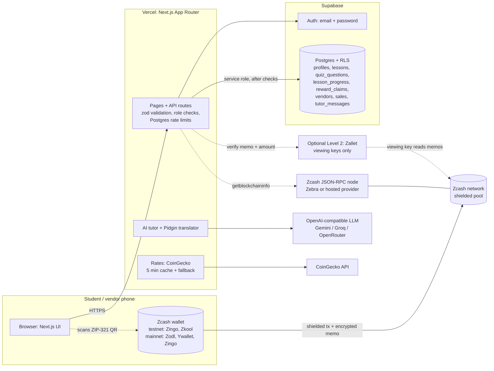

# ShieldCampus

**Every Nigerian student's first private payment.**

ShieldCampus is a learn → earn → spend loop for university campuses. Students learn why financial privacy matters, with an AI tutor that speaks English and Nigerian Pidgin. They set up a shielded Zcash wallet and earn a small ZEC reward, often their first private transaction. Then they spend it at campus vendors who accept ZEC through a simple QR till. Sponsors see the impact on a public dashboard backed by the reward fund's viewing key, while every student's payments stay private.

> We didn't just build an app. We onboarded real new Zcash users at this conference.

- **Live:** https://shieldcampus.vercel.app
- **Impact dashboard:** https://shieldcampus.vercel.app/impact
- **Built at:** BlockchainUNN Conference 5.0, University of Nigeria, Nsukka. Theme: *Intelligence Without Borders: AI & Web3*. Zcash bounty.

---

## The problem

Nigerian students move money constantly: food at the bukka, printing for projects, data, haircuts, transfers between friends. Every one of those payments leaks information:

- **Bank transfers** show your full name and bank to everyone you pay, and your whole history to anyone who picks up your phone.
- **Public blockchains** are worse. A Bitcoin or transparent-address payment is visible to the entire internet, forever. Anyone who learns your address can see your balance and every payment you have made.
- **Visible money attracts trouble:** scammers target people who look like they have funds, people who can see what you receive put pressure on you, and companies profile your spending.

Most students have never used private digital money. They don't know a shielded address exists, and the first steps (installing a wallet, protecting a recovery phrase, receiving a payment) feel risky without help.

## The solution

| | What happens | Where |
|---|---|---|
| **1. Learn** | Five short lessons with quizzes: why privacy matters, transparent vs shielded, wallet setup with checkpoints, ZIP-321 payment requests and memos, viewing keys. An AI tutor answers questions in English or Pidgin. | `/learn` |
| **2. Earn** | Pass the wallet lessons, then claim a shielded ZEC reward to your own `u1…` address. An admin approves it and pays from the reward fund with a ZIP-321 QR code. | `/rewards`, `/admin` |
| **3. Spend** | Campus vendors type a price in naira, and ShieldCampus converts it to ZEC and shows a QR code. The student scans and pays privately. | `/vendors`, `/pos` |
| **4. Prove impact** | Public totals for students, wallets, rewards and merchant payments, plus a PIN-protected sponsor audit of every payout by ID and transaction ID. No names, no addresses. | `/impact`, `/impact/audit` |

## How AI is used

- **A lesson-aware tutor** on every lesson: a side panel on desktop and a bottom sheet on mobile. Answers stream as they're written, using the current lesson as context.
- **English and Nigerian Pidgin.** The tutor answers in the student's language. Lessons can be switched to Pidgin; the AI rewrites them once, the result is validated (headings, tables and warning boxes must survive) and cached for everyone. `npm run translate` pre-generates every lesson before a demo.
- **Safety rules built in.** The tutor stays on topic. It never gives investment advice or price predictions, and it never asks for or accepts a recovery phrase or private key; it warns the student instead.
- **Secrets never leave the phone.** If a student pastes a 12–24 word recovery phrase into the chat, it's detected on the device (using the BIP-39 word list) and blocked before it is sent. The server checks again, and the phrase is never stored or forwarded to the AI provider.
- **Provider-agnostic and resilient.** Any OpenAI-compatible API works through plain `fetch` (Gemini, Groq, OpenRouter, …). Busy providers and network drops are retried, with an optional fallback model. If the AI is down, lessons and quizzes keep working. Requests are rate-limited per student.

## How Zcash is used

- **Shielded addresses only.** Rewards and vendor payments go to unified (`u1…`) or Sapling (`zs1…`) addresses. Transparent `t1…` addresses are rejected with an explanation of why shielded matters. Validation checks the real **Bech32m / Bech32 checksum**: we tested it against the 60 official ZIP 316 test vectors, and it catches one-character typos. It also warns when someone pastes a viewing key, a private key or a recovery phrase into an address field.
- **ZIP-321 payment requests.** Every payout and sale is a `zcash:<address>?amount=…&memo=…` URI, shown as a QR code with an "Open in Zcash wallet" button and copy buttons. Amounts use integer zatoshi maths (max 8 decimals, no trailing zeros). Memos are base64url without padding, capped at 512 bytes. The builder is tested against the ZIP-321 spec examples.
- **Memos link payments to records.** `ShieldCampus reward #ID` and `ShieldCampus sale #ID` are encrypted inside the shielded transaction. Only the sender, the receiver and viewing-key holders can read them, and they let an auditor match each on-chain payout to its claim.
- **Viewing-key accountability.** The reward fund is a shielded wallet. Sponsors get its viewing key, which is read-only and cannot spend, and the `/impact/audit` page lists every payout by ID, amount and txid for them to check. The public sees only totals.
- **Naira pricing.** ZEC/NGN and ZEC/USD come from CoinGecko, cached for 5 minutes with fallback rates. The exact ZEC amount and rate are stored on every sale and reward.

### Why privacy matters for Nigerian students

Privacy here isn't about hiding wrongdoing. It's the digital version of not posting your bank statement on your WhatsApp status. Shielded payments let a student buy lunch, pay for printing or receive money from family without broadcasting their balance and habits to scammers, nosy contacts or data brokers. Viewing keys keep it accountable: sponsors can verify every naira of impact without anyone being exposed.

## Architecture



- **One Next.js app** holds both the frontend and the API routes, with TypeScript strict throughout.
- **Every write goes through a server route:** zod validation, then a role check (student, vendor or admin), then a write with the service role. Browsers can only *read* their own rows under Row Level Security, and quiz answers are never sent to the browser.
- **Rate limits** on login, sign-up, tutor, claim, POS and audit PIN live in Postgres (`check_rate_limit`), so they hold across serverless instances.
- **No spending keys anywhere.** Payouts are sent from the reward fund wallet on an admin's phone by scanning the ZIP-321 QR. The app only ever holds addresses, txids and (optionally, server-side only) a viewing key.
- **`verifyPayment(record)`** (`lib/verification.ts`) returns `verified | pending`. Level 1: a person records the txid (`verified_by = manual`). Level 2: the optional `ZalletVerifier` (`lib/payment-verifier.ts`, `PAYMENT_VERIFIER=zallet`) matches memo + amount through your own Zallet wallet and sets `verified_by = viewing_key`. The app never depends on Level 2 and falls back to manual automatically.
- **Network config** (`lib/network.ts`): `ZCASH_NETWORK=testnet|mainnet` drives address validation, the TAZ/ZEC ticker and the TESTNET badge. `lib/zcash-rpc.ts` is a small typed JSON-RPC client (timeouts, typed errors) used for the node status at `GET /api/zcash/status`.

## Run it locally

You need **Node.js 20.6+**, a free **Supabase** project and an **LLM API key**.

### 1. Supabase
1. Create a project at [supabase.com](https://supabase.com).
2. **SQL Editor →** paste all of `supabase/migrations/20261114000001_init.sql` and run it.
3. **Authentication → Sign In / Providers → Email:** turn off *Confirm email* for the fastest demo. If you leave it on, also set **Authentication → URL Configuration → Site URL** to your deployed URL and add `<your-url>/**` to Redirect URLs.
4. **Project Settings → API Keys:** copy the Project URL, the publishable (anon) key and the secret (service role) key.

### 2. Environment
```bash
cp .env.example .env.local     # Windows: copy .env.example .env.local
```
Fill in at least `NEXT_PUBLIC_SUPABASE_URL`, `NEXT_PUBLIC_SUPABASE_ANON_KEY`, `SUPABASE_SERVICE_ROLE_KEY`, `LLM_API_KEY` and `AUDIT_PIN`. Every variable is documented in `.env.example`.

**AI provider from Nigeria:** Groq blocks some countries, Nigeria included. Use Google Gemini instead (a free key from [aistudio.google.com/apikey](https://aistudio.google.com/apikey)):
```
LLM_BASE_URL=https://generativelanguage.googleapis.com/v1beta/openai
LLM_MODEL=gemini-flash-lite-latest
LLM_FALLBACK_MODEL=gemini-3.1-flash-lite
```

### 3. Install, seed, run
```bash
npm install
npm run seed                          # 5 lessons + 15 quiz questions
npm run translate                     # optional: pre-generate Pidgin lessons
npm run dev                           # http://localhost:3000
npm run make-admin -- you@example.com # after signing up, grant yourself admin
```

### 4. Checks
```bash
npm test          # Vitest: ZIP-321, address checksums + networks, RPC client, payment matching, secret detection, lessons
npm run typecheck
```

## Running on testnet

ShieldCampus runs on the **Zcash testnet by default** (`ZCASH_NETWORK=testnet`). Testnet coins are called **TAZ** and have no real value, so you can rehearse every flow end to end without spending money. While on testnet, the app shows a **TESTNET** badge in the header and on every payment screen, labels amounts as TAZ, and marks naira prices as *demo value (testnet coins have no real value)*. The conversion maths is the same as on mainnet, so the demo looks identical.

1. **Install a testnet wallet.** Zodl doesn't support testnet, so use **Zingo** or **Zkool** (both have mobile and desktop apps). Switch the app to **testnet** before you create the wallet, then write the recovery phrase on paper as usual. Do this for each role: one wallet for the reward fund (admin), one per demo student and one per demo vendor.
2. **Copy the addresses.** On testnet a shielded unified address starts with `utest1` (Sapling: `ztestsapling1`). ShieldCampus rejects mainnet `u1…`/`zs1…` addresses and transparent `tm…` addresses, and explains why.
3. **Get TAZ** for the reward fund wallet from the faucet shared at the Zcash workshop or by the Zcash community. Fund it with `REWARD_ZEC × expected students × 2`, plus fees.
4. **Set up an RPC provider (optional).** Create a Zcash **testnet JSON-RPC** endpoint with a provider such as Tatum, Zec.rocks or QuickNode, and copy its exact URL and API key from the provider's dashboard. It must be a JSON-RPC (Zebra-compatible) endpoint; a lightwalletd/gRPC endpoint won't answer `getblockcount`. Without one, everything still works; the status line just says "no node configured".
5. **Fill in `.env.local`:**
   ```
   ZCASH_NETWORK=testnet
   ZCASH_RPC_URL=<exact URL from your provider>
   ZCASH_RPC_API_KEY=<key, if your provider uses one>
   ZCASH_RPC_API_KEY_HEADER=x-api-key        # change if your provider documents a different header
   REWARD_FUND_ADDRESS=utest1...             # the reward fund wallet's address
   REWARD_FUND_VIEWING_KEY=uviewtest1...     # optional, view-only
   PAYMENT_VERIFIER=manual
   ```
   Restart `npm run dev`. `/admin` and `/impact` should show **Connected to Zcash testnet · block #N**, and `GET /api/zcash/status` returns the same as JSON. If the node is on the wrong chain or the fund address is for the wrong network, `/admin` says so.
6. **Optional Level 2 verification with Zallet.** If you run your own Zallet wallet with the reward fund's (and optionally vendors') **viewing keys** imported, set `PAYMENT_VERIFIER=zallet` plus `ZALLET_RPC_URL`, `ZALLET_RPC_USER` and `ZALLET_RPC_PASSWORD`. Then:
   - when an admin records a reward txid, the server checks that transaction (`z_viewtransaction`) for the memo `ShieldCampus reward #<id>` and the amount (±1%), and marks it `verified_by = viewing_key` on a match;
   - the vendor charge screen gets a **Check payment automatically** button that looks for `ShieldCampus sale #<id>` at the vendor's address (`z_listunspent`) and marks the sale paid.

   If Zallet is unreachable or a method isn't supported, the app falls back to manual txid confirmation. Nothing crashes, and Level 1 always works. Spending keys are never used or stored, and the viewing key and RPC credentials stay server-side.

**Switching networks:** an admin can flip the whole site between testnet and mainnet at **Admin → Zcash network**, with no redeploy. The choice is stored in the `settings` table; `ZCASH_NETWORK` is only the default before an admin picks one. Set `REWARD_FUND_ADDRESS_MAINNET` / `_TESTNET` and `ZCASH_RPC_URL_MAINNET` / `_TESTNET` so the status line checks the right wallet and node on each network (the plain `REWARD_FUND_ADDRESS` / `ZCASH_RPC_URL` still work as fallbacks). After a switch, students and vendors must save an address for the new network: claims, the till and shop QR pages refuse an address from the other network and say why. `/impact`, the audit view and its CSV count mainnet and testnet separately (detected from each payment's address), so practice TAZ never reads as real ZEC. A student can claim each lesson's reward only once, on whichever network they claim first; run `npm run reset-for-mainnet` to start the numbers from zero.

**Privacy trade-off:** a public RPC provider can see your server's IP address and the calls it makes (block-height lookups). It never sees users' wallets, because ShieldCampus doesn't send addresses or keys to it. For full privacy, run your own Zebra node and point `ZCASH_RPC_URL` at it (the testnet RPC default is `http://127.0.0.1:18232`).

## Deploy to Vercel

1. Push to GitHub, then **Import** the repo in Vercel (it detects Next.js).
2. Add every variable from `.env.local` under **Project → Settings → Environment Variables (Production)**, and set `NEXT_PUBLIC_SITE_URL` to your Vercel URL.
3. Deploy. After that, every push to `main` deploys automatically.

Or from the CLI: `vercel link`, then `vercel env add <NAME> production` for each variable, then `vercel deploy --prod`.

Dependencies are pinned in `package-lock.json`, and the project `.npmrc` keeps it that way. Keep Next.js on a patched release, because Vercel refuses to deploy versions with known vulnerabilities.

## Reward fund wallet and viewing key

1. **Create a dedicated wallet** for the reward fund, on a phone that only the admin team uses. Use a shielded wallet such as **Zodl** (formerly Zashi), **Ywallet** or **Zingo**. Write its recovery phrase on paper and keep it offline. It never goes into this app, `.env` or any website.
2. **Fund it** with enough ZEC for `REWARD_ZEC × expected students × 2`, plus fees. Check today's price on `/admin` or `/impact` and set `REWARD_ZEC` and `DAILY_REWARD_CAP` to match your budget.
3. **Pay rewards:** in `/admin`, click **Approve**, scan the QR with the fund wallet, send, paste the txid and click **Mark as paid**.
4. **Export the viewing key** for sponsors. In your wallet, look for the option to export or back up the *unified full viewing key* (it starts with `uview1…`). Ywallet and Zingo offer this; the exact menu varies by version. Share it only with sponsors and auditors. It can see the fund's payments but cannot spend.
5. **Optional Level 2 verification:** put the same key in `REWARD_FUND_VIEWING_KEY`, import it into your own Zallet wallet, and set `PAYMENT_VERIFIER=zallet` (see [Running on testnet](#running-on-testnet), step 6). Level 1 manual txids work without it.

**Practising without real money:** use testnet (the default, see [Running on testnet](#running-on-testnet)) and pay with TAZ from Zingo or Zkool. Every flow can also be rehearsed with a made-up 64-character txid.

## 3-minute live demo script

| Time | Who | What to show |
|---|---|---|
| 0:00–0:20 | Presenter | Homepage: *"Your first private payment starts here."* Point at the **live numbers**: real students from this conference. |
| 0:20–1:00 | Student (phone) | Sign up, open **Lesson 3: Set up your Zcash wallet**, and tap **Pidgin**. Ask the tutor *"Make I share my seed phrase with support?"* and show it refuse. Paste 12 words and show the red block: the phrase never left the phone. |
| 1:00–1:30 | Student | Tick the checkpoints, pass the quiz, save the `utest1…` address from Zingo/Zkool (paste a `tm…` or a mainnet `u1…` first to show the rejection), then **Claim reward**. |
| 1:30–2:00 | Admin (laptop) | **Admin → Approve**: the ZIP-321 QR appears. Scan it with the reward fund wallet and send. Paste the txid and click **Mark as paid**. The student's phone shows **Paid** with the txid. |
| 2:00–2:35 | Vendor (phone) | **Till**: type ₦1,500 for printing and tap **Charge**. The QR shows the ZEC at the live rate. The student scans with Zodl and pays, then the vendor taps **Mark as paid**. |
| 2:35–3:00 | Presenter | **/impact**: the counts have moved. Open **/impact/audit**, enter the PIN, and show every payout by ID and txid with no names or addresses. *"Sponsors can audit every payout; the public sees nothing individual. A viewing key cannot spend."* |

## Impact metrics

Live at **/impact**, refreshed every minute and updated instantly when a payout or sale completes:

| Metric | Definition |
|---|---|
| Students registered | Accounts with the student role |
| Lessons completed | Lesson passes (2 of 3 quiz answers correct) |
| Wallets set up | Students who passed the wallet setup lesson with every checkpoint ticked |
| First private transactions | Distinct students who received a shielded reward |
| Rewards paid | Paid reward claims, with total ZEC and its naira value |
| Active vendors | Approved shops |
| Merchant payments / volume | Paid sales, in NGN and ZEC at each sale's locked rate |

The **sponsor audit** (`/impact/audit`, protected by `AUDIT_PIN`) lists every reward payout and merchant payment with date, type, ID, ZEC amount, txid and verification method. It's also downloadable as CSV. There are no student names or addresses; IDs only.

## Security and safety

- We never ask for recovery phrases or private keys. The wallet lesson opens with a clear warning, the tutor refuses, and pasted phrases are blocked on the device.
- Secrets stay server-side. The service role key and LLM key are never sent to the browser, and no spending key exists anywhere in the system.
- Role checks on every protected route, plus RLS on every table. Users can only update safe profile columns, and quiz answers are server-only.
- Rate limits on sign-up, login (per IP and per email), tutor, translation, claims, POS, address changes and the audit PIN.
- Anti-abuse rules for rewards: students only, the lesson must be passed, one claim per lesson, one account per wallet, a daily cap and admin approval. An approved vendor that changes its receiving address goes back to pending.
- Updates are race-safe (conditional status transitions), and txids are unique across all records.

## Roadmap

- **More campuses.** UNN first, then UNEC, UNILAG and UI, with a campus field on vendors and per-campus impact.
- **Pollar cash-out to naira.** Let vendors convert ZEC to naira through Pollar (integration point planned in `lib/pollar.ts`).
- **Fully automatic viewing-key verification.** Today Level 2 checks on demand through Zallet. Next: a background job that polls every 30 seconds and marks payouts verified without anyone typing a txid.
- **Vendor loyalty rewards.** Small ZEC bonuses for a student's first purchase at a new vendor, funded by sponsors.
- **More Nigerian languages.** Igbo, Yoruba and Hausa lessons and tutor answers, next to English and Pidgin.

## Project layout

```
app/                 Pages and API routes (App Router)
  api/               auth, lessons (quiz, checkpoints, translate), tutor, rewards,
                     admin (claims, vendors), pos (sales), impact (audit, csv)
components/          UI kit (ui/), lesson, tutor, pos, admin, impact, zcash
lib/                 zcash.ts (addresses, ZIP-321, zatoshis), llm.ts, tutor.ts, translate.ts,
                     safety.ts, rates.ts, verification.ts, impact.ts, audit.ts, auth.ts, env.ts,
                     network.ts (testnet/mainnet), zcash-rpc.ts, zcash-status.ts,
                     payment-verifier.ts + payment-match.ts (Level 1 manual / Level 2 Zallet)
scripts/             seed.ts, translate.ts, make-admin.ts, content/lessons.ts
supabase/migrations/ Schema, RLS policies, triggers, rate limiter
tests/               Vitest unit tests
```

## Team

Built by a 3-person team for BlockchainUNN Conference 5.0. Campus photos: Wikimedia Commons, CC BY-SA 4.0 (credited on the page).
